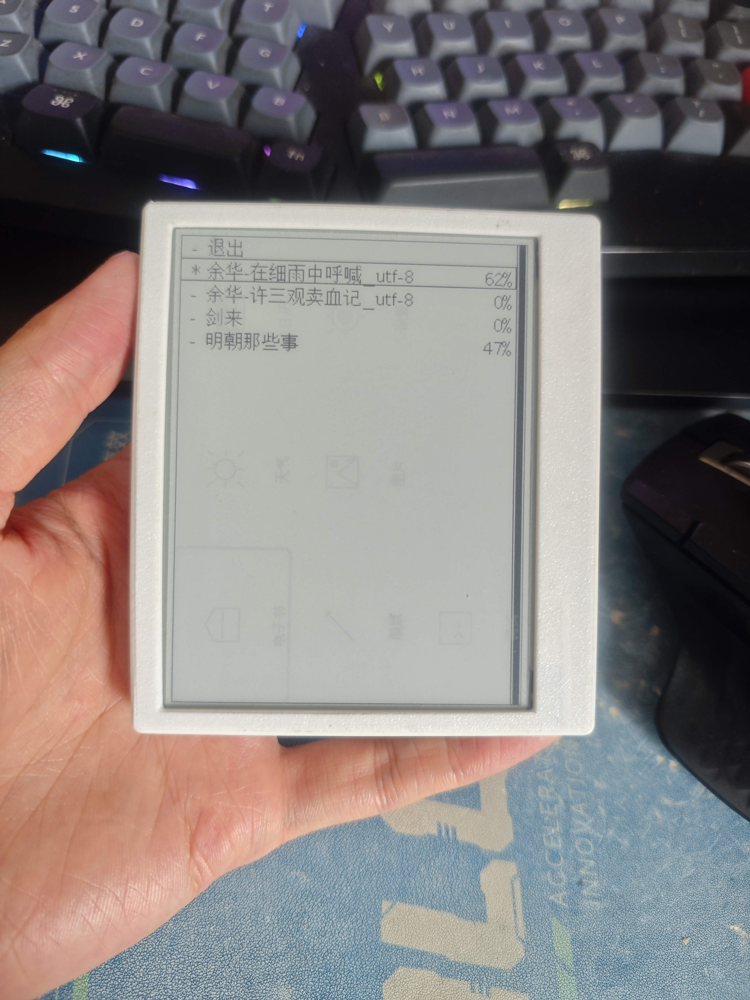
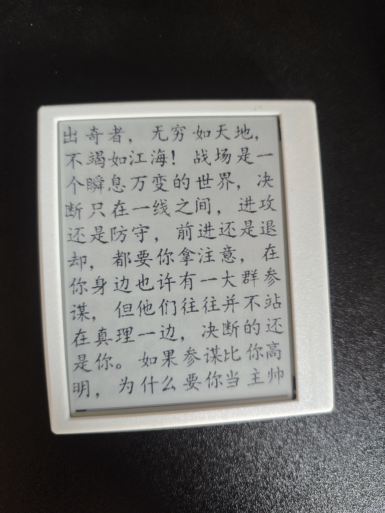
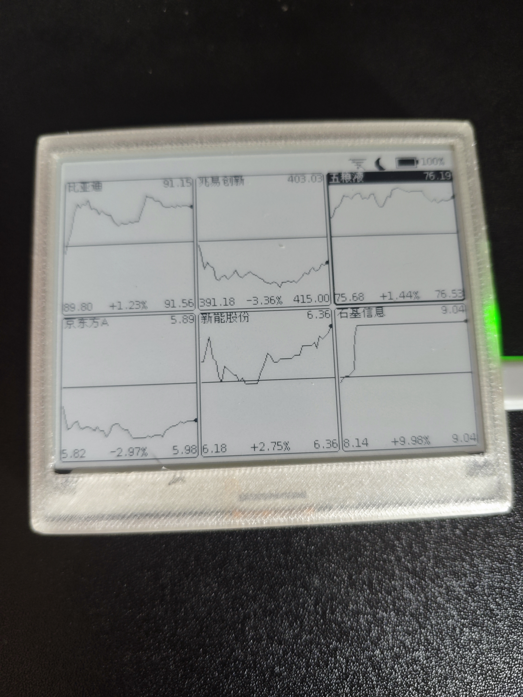

# EPD Reader

> 中文 | [README.md](README.md)

An e-paper reader based on ESP32-C3, developed in Rust with `#![no_std]` embedded development.

Supports WiFi provisioning, NTP time sync, TXT/TTF e-book reading, weather forecast, lunar calendar/holidays, Shanghai & Shenzhen stock quotes, BMP image viewing, IP-based auto location, hardware RTC timekeeping, auto sleep, web configuration, and more.

Hardware design: https://oshwhub.com/longxiangam/epd_reader

Detailed design document: [DESIGN_EN.md](DESIGN_EN.md)

## Screenshots

<table>
  <tr>
    <td align="center"><br>Main menu</td>
    <td align="center"><br>Bookshelf / progress</td>
    <td align="center"><br>E-book reading</td>
  </tr>
  <tr>
    <td align="center"><br>Weather</td>
    <td align="center"><br>Lunar calendar</td>
    <td align="center"><br>Stock intraday</td>
  </tr>
  <tr>
    <td align="center"><br>Realtime quote board</td>
    <td align="center"><br>Image viewer</td>
    <td align="center"><br>Settings</td>
  </tr>
  <tr>
    <td align="center"><br>QR provisioning</td>
    <td></td><td></td>
  </tr>
</table>

## Features

| Feature | Description |
|---------|-------------|
| E-book reading | TXT files with TTF vector fonts and dynamic pagination (fonts selectable from SD card) plus built-in bitmap fonts; bookmarks, two-level book list, typography settings (font size / line spacing / stroke bolding / rotation / key swap), progress saving |
| Weather | Seniverse / OpenMeteo dual data sources, 5-day forecast + temperature chart + indoor temperature & humidity (onboard AHT20 on v2), IP-based auto location |
| Lunar calendar | Gregorian/lunar comparison, solar terms, holidays + makeup workday markers, with 3-day weather |
| Stock quotes | Shanghai & Shenzhen stocks: intraday / daily K / weekly K / monthly K / line chart + realtime board, multi-stock switching; refreshes every 2 minutes during market hours, sleeps until the next open otherwise (holiday-aware) |
| Image viewer | BMP image viewing; can be set as the standby wallpaper |
| WiFi provisioning | AP-mode hotspot, scan QR code with a phone, web management UI (book/image/wallpaper upload and management) |
| NTP time | Automatic network time sync; sync results are written to the hardware RTC, which is preferred on wake-up |
| Hardware RTC | PCF8563 (onboard on v2, CR2032 backup, UTC timekeeping): system clock source + deep-sleep timed wake-up (second/minute countdown and absolute-time alarm) |
| Battery & display | ADC battery sampling and percentage display; configurable full-refresh interval / default home page / per-page sleep timeouts |
| Low power | Automatic deep sleep, button/timer wake-up, independent control of peripheral power rails |
| Error log | Custom panic handler; crash info written to Flash |

## Hardware Requirements

| Component | Specification |
|-----------|---------------|
| MCU | ESP32-C3 (RISC-V, 160MHz, 400KB SRAM, 4MB Flash) |
| Display | Waveshare 4.2" (400×300) / 2.7" (264×176) / 2.9" (296×128) e-paper |
| Storage | MicroSD card (≤32GB, SD/SDHC, MBR partition table); TTF fonts placed in the card root are selectable |
| Input | 3 buttons (v1 legacy board: key 1 direct on GPIO9, keys 2/3 via GPIO2 ADC ladder; v2 new board: all three keys on a GPIO4 ADC ladder) |
| Sensors | v2 new board: onboard AHT20 temperature/humidity + PCF8563 hardware RTC (I2C); v1 legacy board: none |
| Power | Li-ion battery + ADC voltage sensing |

## Tech Stack

- **Language**: Rust Edition 2024 (nightly), `#![no_std]`
- **Target**: `riscv32imc-unknown-none-elf`
- **HAL**: esp-hal v1.1.1
- **WiFi**: esp-radio v0.18.0
- **Async**: Embassy (executor v0.10, net v0.9, sync v0.8)
- **RTOS**: esp-rtos v0.3.0
- **Graphics**: embedded-graphics v0.8
- **Fonts**: u8g2-fonts (GB2312 bitmap) + ab_glyph_rasterizer (TTF vector rasterization)
- **File system**: embedded-sdmmc ([fork, lfn-create branch](https://github.com/longxiangam/embedded-sdmmc-rs), supports creating LFN/Chinese file names)
- **HTTP/TLS**: reqwless v0.14 + embedded-tls v0.18

## Build

The nightly toolchain is required (see `rust-toolchain.toml`). The firmware already exceeds the default debug size limit, so you **must build in release** (`[profile.release] opt-level = "s"` in `Cargo.toml`); otherwise `.text` overflows the 3MB app partition at link time.

Features are two-dimensional: `epd_*` selects the display (epd2in9 / epd2in7 / epd4in2), `board_*` selects the board (board_v1 legacy / board_v2 new v22). A device = epd + board combination (the v2 new board only supports epd4in2).

```bash
# Install the toolchain
rustup target add riscv32imc-unknown-none-elf
cargo install espflash

# Build & flash the v22 new board 4.2" version (.cargo/config.toml sets espflash as runner)
cargo run --release --features epd4in2,board_v2

# Build the v1 legacy board 4.2" version
cargo run --release --features epd4in2,board_v1

# Build the v1 legacy board 2.7" version
cargo run --release --features epd2in7,board_v1

# Build the v1 legacy board 2.9" version (weather/calendar pages adapted to the 296×128
# landscape orientation; layout not finely tuned for this size)
cargo run --release --features epd2in9,board_v1

# With debug mode (enters the debug page if an error log exists in Flash at boot)
cargo run --release --features "epd4in2,board_v2,enable_debug"
```

> All three sizes compile. The weather/calendar page layouts of `epd2in9` are adapted to 296×128 landscape; they work fine but the typography has not been finely tuned for that size.

The `weather-openmeteo` feature switches the weather data source to Open-Meteo (Seniverse by default):

```bash
cargo run --release --features "epd4in2,board_v2,weather-openmeteo"
```

## Project Structure

```
src/
├── main.rs              # Entry point and hardware init (reading/normal restart split-mode)
├── board/               # Board abstraction (mod.rs guards + common defs / v1.rs legacy / v2.rs new)
├── display.rs           # E-paper rendering service
├── event.rs             # Event system (button detection + event queue + pub-sub)
├── pcf8563.rs           # PCF8563 hardware RTC (timekeeping + timed-wake arming, v2)
├── aht20.rs             # AHT20 temperature/humidity sensor (v2)
├── i2c_bus.rs           # I2C bus container (v2)
├── wifi.rs              # WiFi STA/AP modes (esp-radio)
├── storage.rs           # Flash persistent storage
├── sleep.rs             # Deep sleep and wake-up (tiered PCF timed-wake arming)
├── ttf_sd.rs            # On-demand TTF glyph parsing & rasterization from SD
├── worldtime.rs         # NTP time sync (results written to PCF8563)
├── weather.rs           # Weather data service
├── location.rs          # IP-based geolocation (auto-sets the weather city)
├── request.rs           # HTTP/HTTPS client
├── battery.rs           # Battery ADC sampling
├── epd2in9_txt.rs       # TXT text pagination engine
├── sd_mount.rs          # SD card file system
├── flash_sleep.rs       # Standby wallpaper Flash storage
├── web_service.rs       # WiFi provisioning web service
├── panic.rs             # Custom panic handler
├── model/               # Data models (weather, lunar calendar, holidays, stocks)
├── widgets/             # UI widgets (icon grid, list, calendar, K-line/charts, etc.)
└── pages/               # Pages (main menu, bookshelf, reading, weather, calendar, stocks, images, settings, debug)
```

## Tool Scripts

Helper tools live in `tools/` and require Python 3 + Pillow (`pip install Pillow`).

### bmp_converter.py — Sleep image converter

GUI tool that converts any image into a 300×400 monochrome BMP for the e-paper standby screen.

```
python tools/bmp_converter.py
```

- Image selection with live conversion preview
- Binarization: Floyd-Steinberg dithering (recommended) / simple threshold
- Threshold adjustment and inversion
- The output BMP is written to Flash via web provisioning or the SD card

### download_weather_icons.py — Weather icon downloader

Downloads SVG weather icons from [QWeather Icons](https://github.com/qwd/Icons), converts them into 32×32 monochrome BMPs in `icons/weather/` for the weather page.

```
python tools/download_weather_icons.py
```

- Requires `resvg.exe` in the same directory (SVG → PNG renderer)
- Download → PNG render → grayscale scaling → binarization → BMP save
- Covers 20 weather types (sunny, cloudy, rain, snow, fog, haze, etc.)

### convert_default_sleep.py — Default standby image generator

Converts `files/sleep.bmp` into the raw 1-bit pixel binary `files/sleep_default.bin`, compiled into the firmware via `include_bytes!` as the default standby screen.

```
python tools/convert_default_sleep.py
```

- No GUI; runs directly from the command line
- Outputs packed pixel data at 300×400 (38 bytes per row, 15200 bytes total)

## Known Limitations

- Only ≤32GB SD/SDHC cards with an MBR partition table are supported
- The SD card must be communicated with once after power-up, or it interferes with SPI display communication

## License

MIT License
